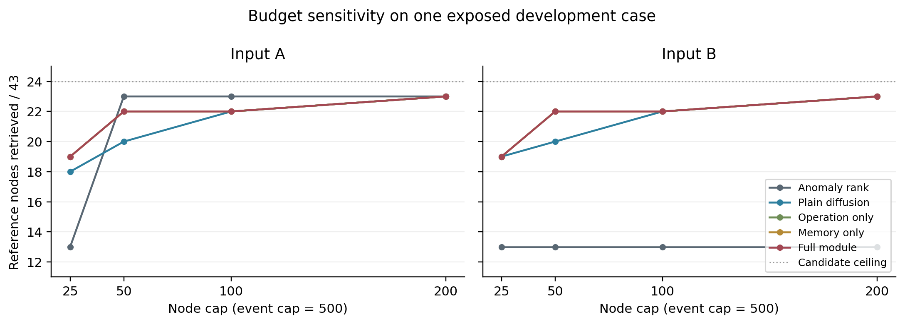
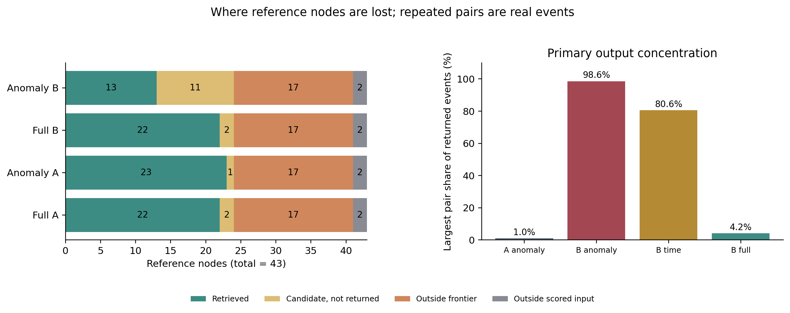
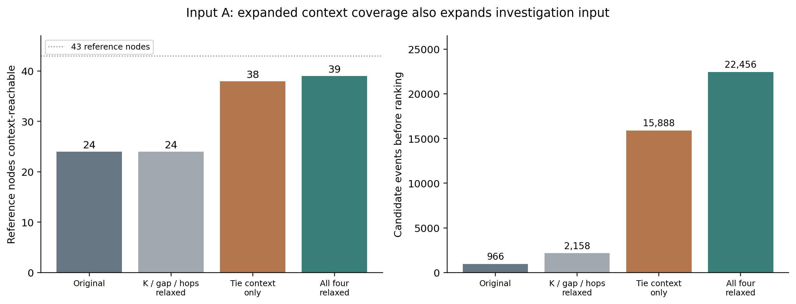
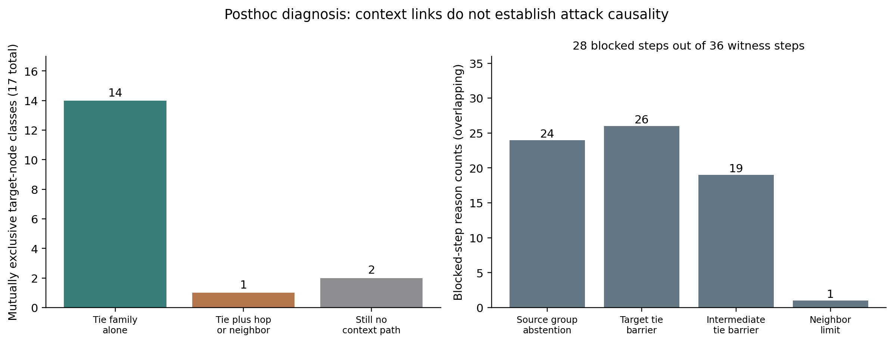

# APT攻击过程重构研究：截至2026年10月31日的详细进展总结

> 本文是跨阶段内部研究总结，不是论文录用级贡献声明。重点汇总最近的“数据与基线落实→配套训练→统一对照→误差分解→候选前沿定位”，并按现有结项报告交代历史工作。早期报告属于可继承的历史证据，本次没有重新执行全部历史实验。文末E01—E32提供来源与复核入口。

## 1. 执行摘要：现在到底做到哪一步

目前已经完成了数据与基线选择、ORTHRUS作者实现的首个真实CPU流水线、配套特征与20轮GNN训练、冻结告警Q、同Q同预算方法对照、诊断片段核验，以及候选前沿的具体失败定位。

已经有可运行代码、模型、实际输出和负面结果，不能再概括成“只在找数据、没跑过基线”。但是，当前也没有证据证明已经形成稳定优于强对照的新APT过程重构算法。

|问题|截至当前的明确回答|
|---|---|
|主数据集确定了吗？|确定。当前实际主线为DARPA TC E3 CADETS，开发案例为graph_12；不是SAGA或DiagChain。|
|主基线确定了吗？|确定。ORTHRUS作者实现；同时用明确身份的简单检索/传播和消融作受控对照。|
|作者基线跑通了吗？|首个真实单案例CPU生产链、推理、作者评价与调查重构已跑通；不是论文全部数据与指标的完整复现。|
|后来又训练了吗？|完成训练期配套Word2Vec＋20轮GNN，验证选中第19轮，冻结18个告警节点。|
|统一对照跑了吗？|跑了。A/B两个输入、7类方法及敏感性控制，共148份冻结输出。|
|复杂模块是否明确胜出？|没有。主预算未支持增益；部分低预算和成本优势保留，但不能归为联合机制不可替代。|
|是否找到具体失败原因？|找到。候选覆盖不足、事件预算集中，以及输入A上的并列时间组弃权/屏障。|
|是否已有完整攻击活动或因果路径F1？|没有。现有主要参考为43个正例节点，不能自动扩成活动或因果路径真值。|
|下一组三臂实验跑了吗？|没有。方案已冻结为PROPOSED_NOT_RUN，C1候选策略仍是待实施扩展。|

最重要的新认识是：**当前优先问题已经从“再加复杂传播模块”收敛到“候选前沿如何保留不确定上下文，以及输出预算如何被重复访问消耗”。**

## 2. 研究目标、当前可评价任务与边界

### 2.1 最终研究目标

目标仍是面向主机审计日志和系统溯源图的APT攻击过程重构：从调查线索出发，恢复有原始证据支持的活动与操作联系，并对证据不足的部分保留UNKNOWN。系统操作依赖、上下文关联、作者报告顺序和攻击因果必须分别标记。

### 2.2 当前实际完成的任务层次

当前实验真正能评价的是“给定告警Q，在有限节点和事件预算下检索已知攻击参考实体及有限相关操作”。它更接近带种子的预算化图检索和部分可观测上下文扩展。

这不等于已经完成攻击活动解缠或多阶段因果链恢复。一个进程可以参与多种活动，同一文件可以被无关进程访问；共享实体只提供上下文，不自动构成攻击因果。

### 2.3 当前成功与尚未成立的主张

- **已确认事实：** 工程链跑通，模型和Q冻结，方法输出存在，输入压缩关系核验，失败可定位。
- **当前研究判断：** 主预算没有支持复杂模块增益，应先解决候选覆盖与预算消耗。
- **有依据的设计方向：** 保留组内顺序未知，同时允许不同时间组间有来源的调查上下文。
- **尚未验证：** 新候选策略能否在固定预算下改善检索，能否跨独立攻击成立，能否支持真正的活动/因果恢复。

## 3. 历史工作已经做过什么

本节根据实际存在的历史结项报告归纳，未把历史输出冒充最近一轮新结果。旧阶段的阻断也不能覆盖后来的成功，例如ORTHRUS在10月26日阻断，10月30日已跑通首例。

### 3.1 数据、参考与复现资产

|工作线|已形成的资产|当前定位与限制|来源|
|---|---|---|---|
|SAGA r13—r19|百万级生成日志处理、实体/事件关联、固定预算检索、原生操作与跨能力组检查|复杂扩展未显示稳定超过简单父进程上下文的过程恢复增量；不是当前主评分数据|E06|
|DiagChain历史阶段|真实控制器与桥接执行、冻结后作者评价、Reflection开关及轨迹分析|探索性结果有曝光和元数据限制；不作严格无泄漏盲测或通用因果准确率结论|E06|
|E5、APT29及关系参考核验|文件/身份/会话/原生锚点和参考适用性方面的历史检查|属于前期可评价性工作，本汇总不声称重新核验每次扫描或把它们计入本轮148输出|E06、E25—E26|
|AIRTAG作者调查组件|实际858节点、1816边、28条added补边；字段支持与拓扑影响审查|6条有发布操作字段支持、22条主要是上下文；未证实错误攻击因果，组件运行不等于完整端到端复现|E05—E06|
|NODLINK|历史真实训练/检测资产及作者源码|不能说从未运行；但当前未完成与本TC E3同输入、同Q、同预算的可靠调查模块对照|E05|
|ORTHRUS / PROVSEEK / OCR-APT / KnowHow核查|四方法独立环境、源码/入口、实际有限执行及阻断记录|四者不能统称完整复现；后来的ORTHRUS首例完成需单列更新|E02、E04|
|MINOS核查|相关方法、发表与官方实现获取方面的审查记录|没有确认完整官方源码，不把自写近似实现称官方基线|E05|

### 3.2 新算法原型不是只写过名字

|原型|实际做过的工作|主要结果|当前结论|
|---|---|---|---|
|DGPR-V1|实现证据接口、候选解释、分歧评价、查询选择、更新与输出；历史最终套件含280回合实际缓存查询和人工机制夹具|与强覆盖/一般不确定性及同约束检查相比，没有锚点上游操作恢复的独立增量|REVISE，工程实现保留，结构分歧价值未证实|
|DGPR-V2|实现动态证据前沿、未完成需求和两步条件规划；修复V1在无显式分歧时提前停止|60/60条件的动作、来源与上游集合被简单Frontier Greedy复现；复杂规划计算更多|功能修复成立，当前Full论文算法主张REJECT|
|COWR|实现跨操作条件路径、可能/必要/统一路径判断和证书；有真实发布片段与小图精确验证|真实16个重复条件的判断被同状态/同约束强对照复现，未证实攻击因果路径提升|实现保留，当前独立算法主张REJECT|
|JACR-01|实现背景模型、联合活动/联系选择、强对照和消融；1344份历史冻结输出|过程项消融64/64不改变选择；同目标精确方法在完成条件中复现或改善，匹配成本后也无持续优势|当前联合选择独立增量不成立，REJECT|

以上计数是历史条件、回合或输出数量，不是同等数量的独立攻击。来源：E25—E28。**有工程实现、有负面实验，不等于已经得到可发表的新算法；反过来也不能说这些阶段什么都没做。**

## 4. 文献与经典问题映射做了什么

已交付55篇跨领域文献清单，分为安全溯源17、NLP事件理解22、图与时序异常16。原综述记录的检索窗口为2023-10-30至2026-10-30。阅读深度主要是摘要与选定正文片段，不是55篇全部全文精读、代码审计或复现；Crossref第二数据库核验并未全部完成。本次汇总核对了清单、行数、元数据与文件哈希，没有重新对每一篇作发表资格认证。（E07—E08）

形成的主要认识：

1. NLP的事件—论元—关系联合建模、会话解缠可启发活动表示，但文本事件共指不等于系统操作属于同一攻击活动。
2. 异常检测提供分数，不提供完整攻击真值；高损失不能直接当作攻击后验概率。
3. 多告警连接、Steiner/森林选择、任务分段、知识对齐、主动查询已有直接先例，不能用新缩写或拼接模块证明原创性。
4. 对当前已有输入，最小可执行问题应落到同Q、同观测、同输出预算的可检验差异，而不是继续扩大概念框架。

文献工作提出了可检验方向，后续实验也确实削弱了“操作门控＋传播记忆必然有增量”的预期，不能因调研有启发就跳过强对照。

## 5. 当前到底用什么数据、输入和参考

### 5.1 主数据和案例

主数据明确为DARPA TC E3 CADETS/CDM18。当前已实际完成的开发案例是graph_12，固定节点参考为`node_Nginx_Backdoor_12.csv`。CADETS其他日期和THEIA案例属于后续扩展，不能写成已经完成多个独立测试案例。（E01—E03）

五个已有普通JSON文件实际读到EOF，共22345275条记录/行、19278748727字节。全文件做身份/哈希及字段扫描，但不能说所有JSON都经过完整语义解码核验。配套训练阶段对保留事件及必要描述符作定向解析。（E02、E10）

graph编号是作者建图日界下的日期标识，不是第几个独立攻击实例。日志日期解释与本报告日期、用户所在时区分开，不能为了对齐而猜测时区。

### 5.2 输入由哪些字段组成

输入包括实体身份、原生操作类型、时间、进程/文件/网络对象信息、实际原生事件身份及其来源。事件UUID曾出现跨日期/成员复用，因此采用UUID＋整数时间戳＋操作的复合事件键并校验端点，而非把事件UUID假定为全局唯一。

最终研究输入形式是“系统观测＋调查起点Q＋预算”，不是直接输入攻击标签生成路径。当前Q来自配套模型的冻结阈值。作者节点标签只在预测冻结后用于评价。

### 5.3 参考能评价什么

|参考资产|实际数量或状态|可以支持|不能自动支持|
|---|---|---|---|
|固定作者节点正例|43个UUID|节点命中、Recall43、评分/候选覆盖|完整事件标签、活动归属、因果边或路径F1|
|进入模型评分域的参考|41个|评分域内的分母说明|把缺失2个归罪于排序器|
|有限调查相关操作|3条，来自2个诊断片段|对这3条操作的命中核对|全部事件相关性、活动完整性|
|完整活动成员参考|未建立|UNKNOWN与限制说明|活动解缠准确率|
|完整攻击因果参考|未取得|不计算相应指标|因果Edge/Path F1|
|已确认正常/无关负例|当前诊断中没有|保持未标注为UNKNOWN|真实攻击Precision或假阳性率|

2个参考进程在作者入口的建图阶段因FORK/ACCEPT不在10类操作白名单而未进入测试图。该原因已在原首例报告中核验，适用范围是这次导入/建图入口，不能外推所有官方预建版本。A/B对照没有顺便补回这两类操作。（E02、E10、E12）

### 5.4 TC E3是否涉及多步攻击

官方材料和历史报告描述了多阶段攻击行为，当前案例也涉及不同系统操作和调查阶段。但“数据集存在多阶段攻击”与“手里有可评分的逐步骤因果真值”是两件事。现有43节点CSV不提供完整的阶段成员与因果路径标注；失败的执行尝试也不能写成执行成功。

## 6. ORTHRUS作者实现首先跑到了哪里

作者首例真实CPU流水线已经完成：JSON导入→数据库映射→建图→Word2Vec→边特征→一轮训练缓存→发布权重推理→作者节点评价→攻击调查重构，最终工作进程退出码0。原作者源码保持冻结，运行恢复发生在包装层。（E02—E03）

|原作者首例结果|检测|调查重构|
|---|---:|---:|
|返回原生节点|16|99|
|固定43节点命中|3|10|
|Recall43|6.98%|23.26%|
|命中/返回重合比例|18.75%|10.10%|
|作者41正例评分域F1口径|0.10526|0.14286|
|作者MCC口径|0.11691|0.15644|

作者AP约0.03919、AUC约0.82547。F1/MCC/AP/AUC沿用作者节点编码，未标注对象被程序编码为负类；**不能据此确认其真实良性，也不能把这些值称为攻击过程或因果路径指标。**

作者原生评价/重构流程会读取节点标注，源码也存在按测试MCC选择epoch的机制。本次发布权重运行只有一个候选checkpoint，不是多checkpoint测试调优，但仍不能称为严格物理隔离盲测。后续配套版本改为验证集选择模型/阈值、先冻结预测再由独立程序评价；案例本身依然已经曝光。

这次运行证明作者代码在已取得的本地工件范围内可执行，不证明论文全部数据、参数和指标已完整复现。实际日期覆盖不全、特征重新拟合及原生评价内部接口等限制已记录。NODLINK尚未完成与本输入/Q/预算的共同调查对照。

## 7. 先做权重诊断，再做配套训练

### 7.1 8,650条事件上的诊断

对相同前三个验证窗口、相同空历史状态，比较本地一轮权重与作者发布权重：

这里使用的是原首例的graph_2验证窗口；后续正式配套训练使用graph_5验证，不能混同两套划分。

|指标|实际值|
|---|---:|
|事件数|8650|
|本地一轮权重平均损失|0.814865|
|发布权重平均损失|1.598316|
|排序Spearman相关|−0.119822|
|最高1%重合|42/87|

该诊断证明两套分数不同；训练经历和权重同时不同，不能把差异归因于Word2Vec不兼容，也不能仅凭损失判断攻击检测哪套更好。它推动的是配套训练，而不是挑选测试表现好的一套权重。（E09）

### 7.2 配套训练设置和结果

|分区|实际图|窗口数|实际保留事件|
|---|---|---:|---:|
|训练|graph_3、graph_4|184|922978|
|验证|graph_5|93|513335|
|已曝光开发测试|graph_12|92|526169|

Word2Vec只拟合训练期可见实体元数据：105481个唯一token序列、54866个词；128维、skip-gram、window=5、min_count=1、negative=5、50轮、workers=1、seed=4。未知语义使用已知词平均；无已知词时保持零语义向量并保留原节点类型，不对零向量归一化。

GNN在该特征上训练20轮，以验证事件加权NLL最低选checkpoint，同分取最早轮。最终选第19轮，验证损失0.455114238。冻结阈值是该checkpoint验证事件的最大损失12.888322830；节点分数为关联事件损失最大值，两个端点都参与。

|配套结果|实际值|
|---|---:|
|完整训练轮数|20|
|选中轮次|19|
|冻结Q节点|18|
|Q命中固定参考|13/43|
|Q的Recall43|30.23%|
|Q中未标注节点|5，性质UNKNOWN|
|测试评分节点总数|100786|

checkpoint、阈值和Q先冻结，再运行独立评价。这里没有强制Q保持旧运行的16个节点。（E10—E12）

**两次运行不能直接当成单因素改进：** 原作者运行使用测试top20节点KMeans告警；新方案使用验证阈值，训练划分、配套特征/权重和历史状态也不同。可以分别报告3/43与13/43，不能把差值全部归为新算法效果。

训练每轮重置历史，然后按训练→验证连续处理；开发测试恢复选中checkpoint的验证后历史，未回放graph_6..11。历史缺口已记录，不把未观察日期补造成事件。

## 8. 24个诊断片段的计划实际完成了多少

目标原为四类各约6个片段，但最终只得到9个候选、18条可回查原始记录，不能强行凑成24个真实错误。（E10）

|待检验类别|候选数|最终证据状态|
|---|---:|---|
|同进程、不同活动|6|未建立独立活动归属|
|同活动、不同进程|2|未建立完整同活动参考|
|普通操作、关键作用|1|仅有限调查相关性|
|相似正常工作流|0|当前范围内未得到已确认负例|

全部9个完整活动成员判断仍为UNKNOWN。分层名称是抽样假设，不是已确认事实；找不到某类候选也不证明整个数据不存在该类行为。

有3条操作得到独立材料的有限调查相关性支持。其中一个片段里，旧重构保留WRITE、遗漏跨进程执行尝试；返回值−1，不能写成成功执行。该遗漏旧分数约在99.19百分位，不是低异常分数漏失。另一个低分WRITE已被旧重构保留，不能称为新方法要修复的遗漏。

所以，“活动混淆确实是当前强基线主要错误”的原动机尚未得到本轮独立证据支持。这是具体负面结果，不是泛称数据不好。

## 9. 输入A/B和同预算方法对照

### 9.1 A/B只改变压缩与否

- A：作者run-compressed事件。
- B：相同SQL、操作白名单和作者窗口下，压缩前的事件。
- 训练与测试276个窗口逐窗核验，压缩B可精确得到A；B为4563968条、A为1449147条。该合计不含验证分区。
- 测试部分A为526169条、B为1657856条；没有同时新增FORK/ACCEPT。
- 提取使用私有数据库物理副本和只读设置，历史数据库没有启动；临时副本服务已停止。（E10、E14）

### 9.2 比较了什么

七类方法：冻结异常排序、时间排序、普通传播、仅操作门控、仅传播记忆、门控＋记忆，以及保持每行转移总量的随机路由。随机路由5个种子是同一图上的控制，不是5次独立攻击。

同输入内方法共用候选和Q；先在完整时间组上建立关系，再诱导截断，不因截断补出新的最近邻。操作统计只从训练输入估计。主预算100节点/500事件，节点预算包括全部Q。

异常排序臂在A/B上复用同一冻结节点分数，事件取两端点分数的最大值；没有在B上另训模型或为每条新增事件重新生成独立GNN损失。因此相同端点的多次访问会同分，稳定身份打破同分也可能集中事件预算。这属于受控适配，不能称为作者在B上重新推理的原生结果。（E31）

传播主重启率0.2、时间尺度60秒、重复经过同一实体的记忆惩罚0.25，最多100次迭代、L1容差1e-8。随机路由保持行转移总量，以检验变化是否仅来自重启/保留质量差异。这些是固定工程参数，不是经校准的攻击概率。

另有25/50/200节点、100/2000事件及重启率0.1/0.2/0.4/0.6/0.8的预定控制。两种输入共148份预测文件先冻结再评价，不能把它们计为148个独立实验样本。

### 9.3 主预算的全部方法汇总

|输入|方法|实际节点|实际事件|参考命中/43|Q外新增命中|有限事件命中/3|
|---|---|---:|---:|---:|---:|---:|
|A|冻结异常分数排序|100|290|23|10|3|
|A|时间距离排序|100|266|22|9|3|
|A|普通传播|100|315|22|9|3|
|A|仅操作门控|100|314|22|9|3|
|A|仅传播记忆|100|311|22|9|3|
|A|门控＋记忆完整模块|100|309|22|9|3|
|A|保持行转移量的随机路由（5种子）|100|289—304|23—24|10—11|3|
|B|冻结异常分数排序|20|500|13|0|0|
|B|时间距离排序|38|500|21|8|3|
|B|普通传播|100|337|22|9|3|
|B|仅操作门控|100|336|22|9|3|
|B|仅传播记忆|100|335|22|9|3|
|B|门控＋记忆完整模块|100|331|22|9|3|
|B|保持行转移量的随机路由（5种子）|100|310—325|23|10|3|

以上命中是固定正例参考重合，不是真实恶意Precision。所有行都来自实际指标文件；随机路由行给出5个种子的范围。（E13）

### 9.4 主预算结论与预算例外

A上异常排序返回100节点/290事件，命中23；完整模块100/309，命中22。时间排序100/266也命中22。简单对照在不更高的实际输出成本下匹配或超过完整模块，主预算没有支持复杂模块增益。

不能扩大成“所有预算都没有差异”：

|输入|节点/事件预算|普通传播命中|完整模块命中|仅门控命中|仅记忆命中|
|---|---|---:|---:|---:|---:|
|A|25/500|18|19|19|19|
|A|50/500|20|22|22|22|
|A|100/500|22|22|22|22|
|A|200/500|23|23|23|23|
|A|100/100|20|20|20|20|
|A|100/2000|22|22|22|22|
|B|25/500|19|19|19|19|
|B|50/500|20|22|22|22|
|B|100/500|22|22|22|22|
|B|200/500|23|23|23|23|
|B|100/100|20|20|20|20|
|B|100/2000|22|22|22|22|

50节点时，完整模块在A/B都比普通传播多命中2个；A的25节点时多1个。但所有12个输入×预算切片中，完整模块节点命中均与单模块相同，且5个随机路由种子均能匹配或超过该命中数。不能把局部差异归成两个模块共同存在所特有的效果。

实际成本也存在必须保留的例外：B的200节点/500事件预算下，完整模块返回166节点、命中23；仅记忆190、仅门控197、普通传播200，也均命中23。它有局部节点成本效率表现，不能被主预算的负面结论抹去。12个切片中9个有比较器严格支配完整模块，另外3个没有；“未被支配”也不等于最优或显著优势。（E16—E17）

普通传播alpha=0.1的A/B两项到100次迭代后未达1e-8容差，保持近似结果，不因标签表现增加迭代；主参数0.2已经收敛。所有差异都只限同一已曝光案例。

## 10. 第二轮分析：漏失在哪个环节

### 10.1 从43到22的互斥分解

独立核对实际节点集合，而不是只拿数量相减：

|环节|剩余参考节点|本环节排除|
|---|---:|---:|
|固定参考全集|43|—|
|进入评分域|41|2|
|进入候选集合|24|17|
|完整模块主预算返回|22|2|

完整模块21个漏失中，19个先于排序发生，占90.48%。该比例是当前43节点参考下的阶段分解，不是90.48%的攻击步骤被漏掉。（E15）

17个“已评分但候选外”的参考实体，均在Q告警窗口内有至少一条关联记录。因此不能简单说这些实体没有被窗口观察到；这也不证明相应攻击行为发生本身已在这些窗口里被完整覆盖。（E18）

### 10.2 B上的事件预算集中

|输出|事件数|不同有向实体对|最大实体对事件数|节点命中|
|---|---:|---:|---:|---:|
|A异常排序|290|266|3|23|
|B异常排序|500|6|493|13|
|B时间排序|500|74|403|21|
|B完整模块|331|286|14|22|

B异常排序的98.6%输出连接同一实体对。500条均是不同原生事件事实，不能直接称为伪造重复、正常噪声或应当删除的无用记录。

已有敏感性结果中，固定B、Q、候选和异常排序，只把事件上限500改为2000，实际返回100节点/858事件，命中从13增至23。这支持预算截断对原结果有实质影响，不证明改了分数模型，也不据此偷偷改主预算。

## 11. 第三轮分析：17个节点为何进不了候选

### 11.1 实际执行与独立复现

只针对A输入，扫描现有526169条压缩测试记录，加载冻结告警窗口中的29072条，得到113条种子事件。独立实现的多源BFS精确复现原966条候选事件身份。

随后枚举四类条件的16个组合：3跳上限、前后8组上限、300秒门限、并列组弃权/屏障。全部图遍历先使用可见事件和Q完成，之后才读参考计数；这是事后开发诊断，不因此变成盲测。（E19—E21）

|放宽条件|候选事件|候选节点|参考实体可达数/43|原漏失17个中可达数|
|---|---:|---:|---:|---:|
|原严格规则|966|421|24|0|
|仅邻居数量|1962|787|24|0|
|仅时间门限|971|426|24|0|
|仅跳数|2113|811|24|0|
|邻居＋时间＋跳数，仍严格并列弃权|2158|811|24|0|
|仅无序并列组上下文|15888|1419|38|14|
|并列组＋邻居数量|21523|2040|39|15|
|并列组＋跳数|22423|2287|39|15|
|四项全放宽，仍限相同窗口|22456|2292|39|15|

### 11.2 17个节点的具体分类

|互斥分类|数量|解释|
|---|---:|---|
|仅并列组规则放宽就可达|14|保持其他原参数也有3跳内上下文见证|
|并列组＋另一条件|1|可以放宽邻居数量，或放宽跳数；两种最小解释都保留|
|四项全放宽仍不可达|2|只表示当前Q、A输入和相同窗口内无共享实体上下文路径|

单独增加跳数、时间范围、邻居数量，乃至三者一起放宽且仍严格处理并列，都没有补回这17个。不能再将它们主要归因于三跳预算太小。

### 11.3 不是必须给并列事件排出先后

15个可达参考节点有16条私有上下文见证，合计36个步骤；全部在一个冻结窗口内，相邻事件共享实体。**没有任何一步直接连接相同时间戳的事件。**

28个步骤被旧规则阻断；其中源时间组弃权涉及24步、目标并列组屏障26步、中间屏障19步、邻居上限1步，原因可以重叠，不能相加当独立错误数量。（E22—E23）

这支持一个更具体的设计方向：保留组内顺序未知，同时允许不同时间组之间有来源的共享实体上下文。保守弃权对操作先后认证可能有必要，但不能直接把它等同于候选检索时必须丢弃整段上下文。

### 11.4 这一发现的代价与未解决部分

仅并列组上下文放宽后，可达参考从24增至38，候选事件从966增至15888，扩大16.45倍。38/43不是固定100节点/500事件下的恢复率，更不是活动或因果路径召回率。

剩余2个在本范围不可达，不证明整个原始归档中没有联系；可能需要不同窗口、其他操作或更完整观测，但本轮没有扩大范围来追查。所有17个都是历史曝光参考，不再具有未触碰验证身份。

## 12. 统计上现在能说什么，不能说什么

**能说：** 每个配置的确切节点/事件数、实际参考重合、同条件差值、种子变化范围、有限图可达性和来源完整性。

**不能说：** 跨攻击总体显著优越、95%泛化置信区间、完整攻击Precision、活动F1、因果Edge/Path F1。当前独立开发攻击实例只有1个；预算、窗口、种子和148个输出都不是独立攻击重复。

6个前沿单元测试和240个小图对照证明相应遍历边界实现与显式枚举一致，20项检索边界测试证明对应程序约束；它们不证明科研假设正确，也不能混入攻击实验样本数。

所有未标注对象保持UNKNOWN。没有把UNKNOWN当作错误，也没有把未运行的下一步写成失败。对于alpha=0.1未收敛两项，保留近似状态，不按完全收敛作强推断。（E29—E30）

## 13. 四张关键图应该怎样理解

### 图1：预算变化后复杂模块是否仍有优势



目的：检查主预算结论能否推广到低预算。应看到50节点时的局部增量和100节点时的持平；单模块与完整模块曲线重合，不能把重合曲线解读成没有实现这些模块。图只展示同一开发案例，不给伪造的跨攻击误差条。

### 图2：漏失阶段与实体对集中



目的：区分输入、候选、排序，以及B异常排序的预算集中。应看到排序前19个参考已排除，以及B异常排序最大实体对占比98.6%。决策是先修候选/预算协议，不是先加更深的模型。

### 图3：候选覆盖与候选扩张成本



目的：让“参考可达从24到38”的正现象与“候选事件扩大16.45倍”的代价同时出现。它不能被单独截取左半图当作新方法恢复率提升。

### 图4：17节点分类与并列组阻断



目的：区分14/1/2的互斥节点分类与可重叠的步骤原因。左图可以合计17，右图不能相加作新样本总数。该图定位候选上下文机制，不证明攻击因果。

## 14. 实际工程交付与资源成本

### 14.1 交付内容

- 作者基线的生产链、真实指标及运行恢复记录。
- 训练期配套Word2Vec、20轮GNN checkpoint、验证选择、告警规则、18节点Q和模型分数；二进制及原生身份留服务器私有目录。
- A/B压缩前后输入及逐窗一致性核验。
- 148份冻结预测、统一指标、预算/重启/随机路由控制。
- 9候选片段和18条原始记录的私有回查，3条有限相关操作参考。
- 148输出的集合核验、120条完整模块对照、事件集中和候选漏失分解。
- 可运行前沿遍历实现、16组合结果、17节点匿名分类、私有见证哈希及屏障核验。
- 中文报告、机器决策、PNG/PDF图、哈希清单与服务器/GitHub回执。

### 14.2 已记录资源

|执行|实际墙钟或成本|限制与说明|
|---|---|---|
|作者首例流水线|约36.21分钟，含恢复间隙|其历史执行范围与后续配套训练不同|
|配套准备/训练至开发预测冻结|6514.79秒，约108.58分钟|主训练4CPU；峰值RSS约10.93GiB|
|A全套检索对照|6.64秒|含操作统计、候选、排序和预算解码，不含GNN训练|
|B全套检索对照|15.86秒|同上；不是148次训练|
|集合误差审计|约0.69秒|另有54,419,522字节跟踪读取，含完整性复读|
|窗口范围查询|约3.93秒|已有表526169行，只读|
|前沿16组合诊断|4.68秒|1CPU，峰值263268KiB，2GiB地址空间/120秒上限|
|见证组补查|约0.015秒|36次聚合查询、589条匹配行，重复匹配重复计入|

不能把这些阶段的RSS峰值相加当总内存，也未测量全项目累计CPU秒或物理I/O。后两轮诊断未读原始归档、未训练、未使用GPU或研究LLM；绘图复用已有Matplotlib。较早四方法阶段曾按当时授权建立独立环境，不能把“最近未安装”误写成整个历史从未安装任何依赖。

### 14.3 运行失败如何处理

保留了复合事件身份冲突、压缩回放汇总错误、运行包装/分词缓存/CPU权重加载等具体失败。修复发生在独立版本或包装层，不把失败记录改成成功，也不把未完成输出当有效预测。

SSH中断后先核对原进程，没有重复启动训练。GitHub API出现TLS超时后，最终通过标准Git HTTPS、既有Lianliantxd凭据和非强制推送完成最近两轮同步；没有修改系统网络配置、关闭证书验证或把凭据写入报告。

## 15. 哪些原先的认识改变了

|原先可能的认识|现在的判断|依据|
|---|---|---|
|数据和基线一直没确定|当前已固定E3 CADETS和ORTHRUS，并实际跑通首例|E01—E03|
|低损失的一轮权重必然检测更好|不能这样判断；不同训练经历与权重混杂，需要配套训练|E09—E12|
|活动混淆必然是已证实主要错误|9候选未建立独立活动归属，当前不能保留强动机|E10|
|操作门控＋记忆应稳定带来收益|主预算不支持；局部正结果可由单模块/随机路由匹配，成本例外保留|E13、E16—E17|
|完整输入自然比压缩输入好|B在简单排序下出现严重事件预算集中，不能预设更好|E13、E15|
|候选漏失主要因为跳数太少|对当前17节点，增加跳数甚至K/时间一起放宽仍无效|E19—E20|
|同时间戳不能定序，所以只能整组弃权|可保留组内未知，同时研究组间上下文；现有见证不要求同时间戳直接连接|E22—E23|
|更大、更连通的图就是更好攻击过程|候选扩大只给潜在覆盖，必须检验固定输出预算和独立关系依据|E19、E24|

## 16. 当前仍未完成什么

1. C0/C1/C2三臂候选策略的固定排序实验未执行，C1扩展尚未作为完成实现交付。
2. 没有完成多个独立攻击实例、跨主机或THEIA外部验证。
3. NODLINK与当前E3输入/Q/预算的可靠共同调查对照未完成；其他方法不能自动视为正式共同基线。
4. 24个诊断片段目标未满足；9候选不是9个已证实活动混淆案例。
5. 完整活动归属、正常负例、攻击因果边/关键路径参考仍不足，相应准确率/F1未计算。
6. 两个未进入评分域的节点没有通过本轮改白名单补回；两个当前上下文不可达节点也没有扩大范围追查。
7. 新机制的独立性、跨实例稳健性和论文级原创性未被证明。

这些不是同一个“缺Ground Truth”问题：分别是实现/执行缺口、候选可观测性、预算协议、任务语义、独立评价和机制增量，必须分开处理。

## 17. 下一步只做什么

唯一优先行动为`THREE_ARM_CANDIDATE_POLICY_PILOT_WITH_FROZEN_RANKER`。方案状态：**PROPOSED_NOT_RUN**。（E24）

|实验臂|候选策略|保持相同的部分|
|---|---|---|
|C0|原严格组弃权/屏障|相同A输入、Q、冻结异常分数、解码器、100节点/500事件主预算|
|C1|不同时间组间允许共享实体上下文，组内顺序未知且不直接添加同时间戳联系；仍8组/300秒/3跳|同上|
|C2|相同窗口的普通共享实体连通分量，作为简单强覆盖对照|同上|

生成端不得读取43节点参考或17个漏失别名；先冻结候选与输出，再评价。记录候选规模、实际输出和成本，不新增模型、训练或操作白名单。

判定规则：C1不优于C0则不保留检索增益；普通C2匹配C1则不建立特殊时间组机制必要性。即便改善，仍先限定为已曝光开发案例的候选/检索工程结果，不自动升级成攻击因果恢复，也不自动进入独立新算法发表阶段。

**本次用户请求是总结，因此本次只核验、编写和同步报告，没有执行上述新实验。**

## 18. 交付索引、同步状态与复核

|交付|已核验提交|公开入口|
|---|---|---|
|55篇文献综述|`bcc7f5349d40`|[已同步目录](https://github.com/Lianliantxd/provenance-/tree/bcc7f5349d404778c270b6ae5224ca085dd5fa93/Research_Updates/20261030_cross_domain_literature_v2)|
|配套训练与统一对照|`5f47f5aad2c9`|[已同步目录](https://github.com/Lianliantxd/provenance-/tree/5f47f5aad2c96fda3e5af3d84d439d8a07a51354/Research_Updates/20261030_fourstep_execution_130726)|
|冻结误差分解|`e1774913ca07`|[已同步目录](https://github.com/Lianliantxd/provenance-/tree/e1774913ca078be2dd453e524c7f97597e3bb5ea/Research_Updates/20261030_frozen_error_decomposition)|
|17节点前沿定位|`b372afa589fc`|[已同步目录](https://github.com/Lianliantxd/provenance-/tree/b372afa589fccfacd5ec173f09f9c0f2826a395e/Research_Updates/20261031_frontier_localization)|

最近三轮工件都已按实际回执同步服务器及Lianliantxd/provenance-独立分支。表中引用固定提交，避免分支后续变化掩盖来源。四方法历史报告有当时“未推送”限制，不能把旧轮未推送状态混同为最近三轮未同步。

本次总结重新校验了三份最近交付的SHA-256清单，覆盖24、28、30个清单内文件；它们是不同交付包，不能相加作独立科研样本数。旧报告按历史证据继承，本次未重新读取大型模型二进制或扫描全部原始数据。

可在相应本机交付目录执行只读复核：

```sh
python3 -B verify_delivery.py
```

该命令检验文件、字段、哈希与程序检查范围，不证明参考完整性、因果正确性或算法优于现有方法。

本工作区根目录没有已识别的Obsidian绑定，本次写入独立本地Markdown文件，未作Obsidian回写。私有版包含实际文件位置；GitHub版保留研究内容并移除私有绝对路径。没有写入任何密码、令牌、原始日志摘录或原生事件身份。

### 18.1 证据来源索引

|编号|来源|证据层次|
|---|---|---|
|E01|主数据与基线固定决定（项目内保留文件：`apt_dataset_baseline_lock_20261029/DATASET_BASELINE_DECISION.md`）|历史决定|
|E02|ORTHRUS作者首例执行报告（项目内保留文件：`orthrus_cadets_run_20261030/FINAL_BASELINE_RUN_REPORT.md`）|历史运行报告|
|E03|ORTHRUS作者首例原始指标表（项目内保留文件：`orthrus_cadets_run_20261030/RESULTS.csv`）|历史指标表|
|E04|四方法复现范围报告（项目内保留文件：`repro_four_methods_20261026/FINAL_REPRODUCTION_REPORT.md`）|历史运行报告|
|E05|AIRTAG与NODLINK共同执行审查（项目内保留文件：`apt_common_baseline_execution_20261027/FINAL_BASELINE_EXECUTION_REPORT.md`）|历史运行报告|
|E06|历史成果收敛与证据总报告（项目内保留文件：`apt_provenance_research_consolidation_20261027/FINAL_RESEARCH_CONSOLIDATION_REPORT.md`）|历史汇总，非本次重跑|
|E07|[55篇跨域文献清单](https://github.com/Lianliantxd/provenance-/blob/bcc7f5349d404778c270b6ae5224ca085dd5fa93/Research_Updates/20261030_cross_domain_literature_v2/PAPER_INVENTORY.csv)|已存在文献索引|
|E08|[55篇阅读深度与方法综述](https://github.com/Lianliantxd/provenance-/blob/bcc7f5349d404778c270b6ae5224ca085dd5fa93/Research_Updates/20261030_cross_domain_literature_v2/REVIEW_55_PAPERS.md)|已存在综述|
|E09|8,650事件权重诊断（项目内保留文件：`apt_research_execution_20261030/validation_probe_01/result.json`）|实际诊断回执|
|E10|[20轮训练与统一对照主报告](https://github.com/Lianliantxd/provenance-/blob/5f47f5aad2c96fda3e5af3d84d439d8a07a51354/Research_Updates/20261030_fourstep_execution_130726/FINAL_MASTER_REPORT.md)|实际实验报告|
|E11|20轮训练结果（项目内保留文件：`apt_research_execution_20261030/runs/20261030T130726Z_fourstep_r2/receipts_final/TRAINING_RESULT.json`）|实际运行回执|
|E12|[新Q检测指标](https://github.com/Lianliantxd/provenance-/blob/5f47f5aad2c96fda3e5af3d84d439d8a07a51354/Research_Updates/20261030_fourstep_execution_130726/DEVELOPMENT_DETECTION_METRICS.json)|冻结后评价|
|E13|[148份检索输出指标](https://github.com/Lianliantxd/provenance-/blob/5f47f5aad2c96fda3e5af3d84d439d8a07a51354/Research_Updates/20261030_fourstep_execution_130726/RETRIEVAL_METRICS.csv)|冻结后评价|
|E14|A/B精确压缩核验（项目内保留文件：`apt_research_execution_20261030/runs/20261030T130726Z_fourstep_r2/receipts_final/COMPRESSION_FACTOR_READY.json`）|实际输入核验|
|E15|[误差分解分析](https://github.com/Lianliantxd/provenance-/blob/e1774913ca078be2dd453e524c7f97597e3bb5ea/Research_Updates/20261030_frozen_error_decomposition/analysis-report.md)|严格分析|
|E16|[成本比较的必要补充](https://github.com/Lianliantxd/provenance-/blob/e1774913ca078be2dd453e524c7f97597e3bb5ea/Research_Updates/20261030_frozen_error_decomposition/COST_SCOPE_ADDENDUM.md)|严格分析限定|
|E17|[预算切片与随机路由统计](https://github.com/Lianliantxd/provenance-/blob/e1774913ca078be2dd453e524c7f97597e3bb5ea/Research_Updates/20261030_frozen_error_decomposition/artifacts/BUDGET_SUMMARY.csv)|描述统计|
|E18|[17节点的窗口范围核验](https://github.com/Lianliantxd/provenance-/blob/e1774913ca078be2dd453e524c7f97597e3bb5ea/Research_Updates/20261030_frozen_error_decomposition/artifacts/CANDIDATE_SCOPE_AUDIT.json)|实际只读查询|
|E19|[16种前沿条件结果](https://github.com/Lianliantxd/provenance-/blob/b372afa589fccfacd5ec173f09f9c0f2826a395e/Research_Updates/20261031_frontier_localization/artifacts/CONDITION_PROFILES.csv)|实际组合诊断|
|E20|[17个匿名节点最小条件分类](https://github.com/Lianliantxd/provenance-/blob/b372afa589fccfacd5ec173f09f9c0f2826a395e/Research_Updates/20261031_frontier_localization/artifacts/FRONTIER_CASES.csv)|实际集合诊断|
|E21|[前沿定位运行回执](https://github.com/Lianliantxd/provenance-/blob/b372afa589fccfacd5ec173f09f9c0f2826a395e/Research_Updates/20261031_frontier_localization/artifacts/RUN_RECEIPT.json)|实际运行回执|
|E22|[私有上下文见证完整性核验](https://github.com/Lianliantxd/provenance-/blob/b372afa589fccfacd5ec173f09f9c0f2826a395e/Research_Updates/20261031_frontier_localization/artifacts/PRIVATE_WITNESS_AUDIT.json)|聚合回执，不含原生身份|
|E23|[见证时间组屏障核验](https://github.com/Lianliantxd/provenance-/blob/b372afa589fccfacd5ec173f09f9c0f2826a395e/Research_Updates/20261031_frontier_localization/witness_group_audit/WITNESS_GROUP_RECEIPT.json)|事后补充诊断|
|E24|[下一步三臂方案](https://github.com/Lianliantxd/provenance-/blob/b372afa589fccfacd5ec173f09f9c0f2826a395e/Research_Updates/20261031_frontier_localization/NEXT_PILOT_PROTOCOL.json)|计划，尚未运行|
|E25|DGPR-V1历史研发报告（项目内保留文件：`dgpr_algorithm_development_20261027/FINAL_DGPR_RESEARCH_REPORT.md`）|历史已执行，不在本次重跑|
|E26|DGPR-V2历史研发报告（项目内保留文件：`dgpr_frontier_development_20261027/FINAL_DGPR_V2_RESEARCH_REPORT.md`）|历史已执行，不在本次重跑|
|E27|COWR历史研发报告（项目内保留文件：`cowr_cross_operation_development_20261027/FINAL_COWR_RESEARCH_REPORT.md`）|历史已执行，不在本次重跑|
|E28|JACR历史研发报告（项目内保留文件：`jacr_joint_reconstruction_20261028/FINAL_JACR_RESEARCH_REPORT.md`）|历史已执行，不在本次重跑|
|E29|[误差分析统计边界](https://github.com/Lianliantxd/provenance-/blob/e1774913ca078be2dd453e524c7f97597e3bb5ea/Research_Updates/20261030_frozen_error_decomposition/stats-appendix.md)|统计限制|
|E30|[前沿诊断统计边界](https://github.com/Lianliantxd/provenance-/blob/b372afa589fccfacd5ec173f09f9c0f2826a395e/Research_Updates/20261031_frontier_localization/stats-appendix.md)|统计限制|
|E31|[冻结检索控制的实际实现](https://github.com/Lianliantxd/provenance-/blob/5f47f5aad2c96fda3e5af3d84d439d8a07a51354/Research_Updates/20261030_fourstep_execution_130726/retrieval_experiment.py)|实际执行源码|
|E32|四步实验协议（项目内保留文件：`apt_research_execution_20261030/experiment_protocol.json`）|运行前固定方案，原状态字段保留|

### 18.2 私有文件位置

完整模型、原始数据、Q身份和原生见证保留在授权私有项目中。公开版本不包含私人绝对路径；本机私有版提供具体定位。

## 19. 最终研究判断

到当前，已经形成一条可运行、可复核的主实验线，以及能改变下一步投入的具体失败解释。最可靠的阶段成果是配套模型/告警、受控检索对照和并列时间组候选屏障的实证定位。

尚不能把这些工作归纳成“已获得稳定超过强基线的新APT攻击过程重构算法”。接下来的必要检验是固定排序下的三臂候选对照，而不是继续堆传播模块、把候选覆盖当最终恢复率，或把同一开发案例反复使用后称为独立验证。
